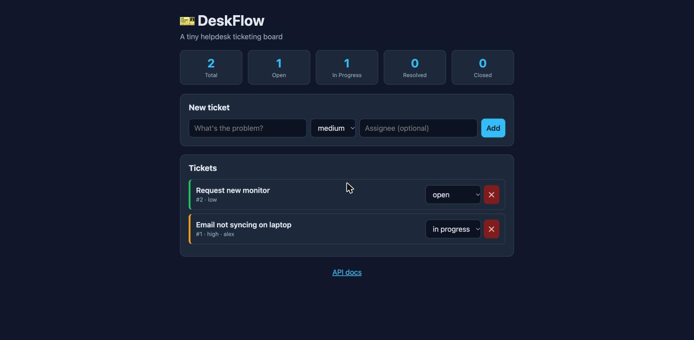
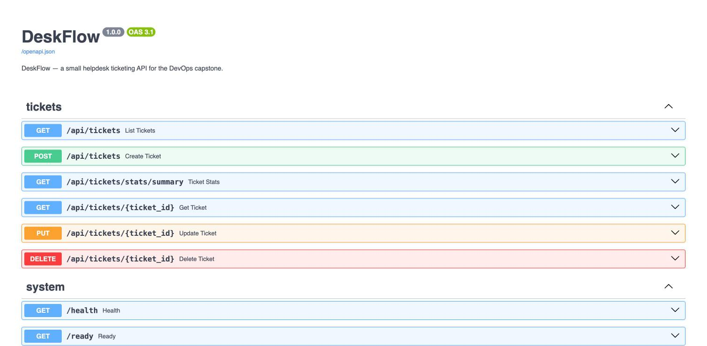
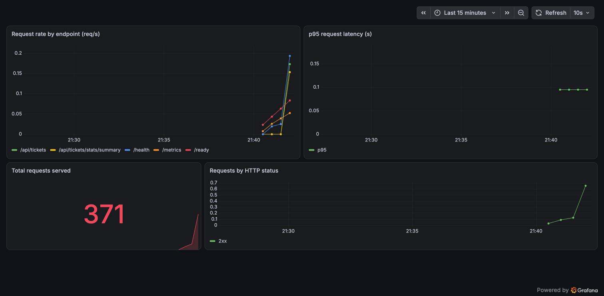

# DeskFlow

DeskFlow is a small helpdesk ticketing app. You create a ticket, give it a
priority, assign it to someone, and move it through open, in progress,
resolved and closed. It also shows a live count of tickets by status and
priority.

The app itself is kept small on purpose. This is my DevOps capstone, so the
real work is the pipeline around the app: tests, containers, CI/CD with image
scanning, infrastructure as code on AWS, a Kubernetes deployment packaged with
Helm, and Prometheus/Grafana monitoring.

## Problem and objectives

Small teams often track support requests in spreadsheets or chat. Tickets get
lost, priority is unclear, and nobody can see how much work is open. DeskFlow
gives one place to track requests, and gives me a realistic app to run through
a full DevOps lifecycle.

## Features

- Create, list, view, update and delete tickets (REST API)
- Priority levels (low to urgent) and status workflow
- Filter by status and a stats summary (counts by status and priority)
- Health, readiness and Prometheus metrics endpoints

## Tech stack

| Layer | Tools |
|---|---|
| Backend | FastAPI, Python 3.12, SQLAlchemy 2, Alembic |
| Database | PostgreSQL |
| Frontend | React + Vite, served by Nginx |
| Tests | pytest with an in-memory SQLite database |
| Containers | Docker, Docker Compose |
| CI/CD | GitHub Actions, GitHub Container Registry |
| Security | Trivy image scanning |
| Infrastructure | Terraform, AWS VPC, Amazon EKS |
| Orchestration | Kubernetes, Helm |
| Monitoring | Prometheus, Grafana |

## Architecture

```
Browser -> Ingress -> / -> frontend Service -> frontend pods (Nginx) x2
                      /api -> backend Service -> backend pods (FastAPI) x2 -> postgres Service -> postgres pod (+PVC)
                                                     \-> /metrics <- Prometheus -> Grafana

CI/CD (push to main): pytest -> build frontend -> build images -> Trivy scan -> push to GHCR (tag = commit SHA)
```

## Project structure

```
deskflow-devops-capstone/
  backend/            FastAPI app, Alembic migrations, tests, Dockerfile
  frontend/           React + Vite SPA, multi-stage Dockerfile, Nginx config
  .github/workflows/  ci-cd.yml
  terraform/          VPC + EKS (AWS modules)
  k8s/                namespace.yaml
  helm/deskflow/      Chart.yaml, values.yaml, templates/
  monitoring/         Grafana dashboard JSON
  scripts/            deploy-minikube.sh, load-test.sh
  troubleshooting/    two broken manifests + guide
  docker-compose.yml  local 3-service stack
  presentation.pptx   slide deck
```

## Prerequisites

Docker. For the cluster parts: kubectl, Helm, minikube. For AWS: Terraform and
the AWS CLI. Python 3.12 and Node 20 if you run things outside Docker.

## Run locally with Docker Compose

```bash
cp .env.example .env     # optional, sets a local DB password
docker compose up --build
```

- App: http://localhost:3000
- API docs: http://localhost:8000/docs
- Health: http://localhost:8000/health





## Configuration

Everything is set through environment variables, so nothing secret is hardcoded.

| Variable | Used by | Default |
|---|---|---|
| DATABASE_URL | backend | from compose / k8s secret |
| POSTGRES_USER/PASSWORD/DB | postgres | .env (gitignored) |
| BACKEND_URL | frontend Nginx | http://backend:8000 |

## Tests

```bash
cd backend
docker run --rm -v "$PWD":/app -w /app python:3.12-slim \
  sh -c "pip install -r requirements.txt && python -m pytest"
```

Result: 12 passed. The suite covers health, create/list/get/update/delete,
status filtering, the stats endpoint, validation errors and /metrics. The
tests use an in-memory SQLite database (see `tests/conftest.py`), so the real
Postgres database is never touched.

## Docker

- `backend/Dockerfile`: python:3.12-slim, runs migrations then Uvicorn, as a
  non-root user (uid 10001).
- `frontend/Dockerfile`: multi-stage, Node 20 builds the SPA, then
  nginx-unprivileged serves it on port 8080 as a non-root user (uid 101).
- `docker compose up --build` starts frontend, backend and postgres together.

## CI/CD

`.github/workflows/ci-cd.yml` runs on every push to main:

1. Install dependencies and run pytest. Build fails if any test fails.
2. If tests pass: build the frontend, build both Docker images (tagged with
   the commit SHA), scan both with Trivy, and push to GHCR.

Images are tagged with the Git commit SHA instead of `latest`, so every image
maps back to one commit.

## Security scanning with Trivy

The first scan of the backend image found HIGH severity CVEs in `starlette`
(a FastAPI dependency), including CVE-2025-62727, a denial-of-service through
Range header handling. The older Nginx/Alpine base in the frontend added more.

With the scan gate set to fail on HIGH or CRITICAL, the build stopped there,
which is the point of the gate. I fixed it by upgrading:

- fastapi to 0.143.3
- starlette to 1.8.0
- prometheus-fastapi-instrumentator to 8.1.0
- the Nginx base to 1.31.7-alpine3.24-slim

After the upgrade both images scan clean (0 fixable HIGH/CRITICAL) and all 12
tests still pass.

## Kubernetes and Helm

```bash
./scripts/deploy-minikube.sh
```

This builds the images, starts minikube, loads the images, and installs the
Helm chart. The chart in `helm/deskflow` deploys postgres (Deployment + PVC +
Service), the backend (2 replicas + Service), the frontend (2 replicas +
Service), an Ingress that routes `/` to the frontend and `/api` to the
backend, an HPA (2 to 5 pods on 60% CPU), and a ServiceMonitor.

Verified on minikube:

```
NAME                                 READY   STATUS    RESTARTS   AGE
deskflow-backend-...-2dtm9           1/1     Running   ...        10m
deskflow-backend-...-zfgxh           1/1     Running   ...        10m
deskflow-frontend-...-cnpfm          1/1     Running   0          10m
deskflow-frontend-...-fhfmf          1/1     Running   0          10m
deskflow-postgres-...-xp7cz          1/1     Running   0          10m

ingress  deskflow  nginx  deskflow.local  192.168.67.2  80
hpa      deskflow-backend  cpu: 5%/60%  min 2 max 5  replicas 2
```

To reach the app:

```bash
echo "$(minikube ip) deskflow.local" | sudo tee -a /etc/hosts
# open http://deskflow.local
# or, without editing /etc/hosts:
kubectl -n deskflow port-forward svc/deskflow-frontend 8080:80
```

## Monitoring with Prometheus and Grafana

```bash
helm repo add prometheus-community https://prometheus-community.github.io/helm-charts
helm upgrade --install monitoring prometheus-community/kube-prometheus-stack \
  -n monitoring --create-namespace \
  --set prometheus.prometheusSpec.serviceMonitorSelectorNilUsesHelmValues=false
```

The backend exposes Prometheus metrics at `/metrics`, and the ServiceMonitor
tells Prometheus to scrape it. Both backend pods show up as UP targets, and the
Grafana dashboard (in `monitoring/grafana-dashboard.json`) shows request rate,
p95 latency, total requests and status codes. Use `scripts/load-test.sh` to
generate traffic and watch the panels move.



## AWS deployment with Terraform

Cost note: an EKS control plane costs about $0.10/hour, plus the worker nodes
and a NAT gateway. This is not free tier. Apply it, capture evidence, and
destroy it the same day so the total stays at a few dollars.

```bash
cd terraform
cp terraform.tfvars.example terraform.tfvars   # no credentials go in here
aws configure                                  # or use an SSO profile
aws sts get-caller-identity                     # confirm the right account
terraform init
terraform plan
terraform apply        # about 15 to 20 minutes for VPC + EKS

aws eks update-kubeconfig --region ap-south-1 --name deskflow-eks
kubectl get nodes

terraform destroy      # tear everything down when finished
```

`terraform init` and `terraform validate` were run and pass.

## IAM and secure authentication

- Authenticate with an AWS CLI profile or IAM Identity Center. Do not put keys
  in code.
- Use a least-privilege identity that can manage VPC, EKS, EC2 and the IAM
  roles the cluster needs.
- No AWS keys appear in any file, commit, log, this README or the slides.
  `.gitignore` excludes `.env`, `*.tfvars` and `*.tfstate`.

## Troubleshooting

See `troubleshooting/` for two labs: an ImagePullBackOff from a bad image tag,
and a Service with no Endpoints from a selector typo, each with the fix. One
real issue during development: the backend pods restarted a few times on first
boot while Postgres was starting. The readiness and liveness probes handled it
and the pods settled once the database was up.

## Cost and cleanup

```bash
cd terraform && terraform destroy   # delete all AWS resources
minikube delete                     # delete the local cluster
docker compose down -v              # stop local stack and remove the volume
```

After `terraform destroy`, check the AWS console that the EKS cluster, NAT
gateway and EC2 nodes are gone, since those are the billable parts.

## Limitations and future work

- Single Postgres pod, no high availability.
- In-cluster DB credentials are chart values; production should use a secret
  manager such as AWS Secrets Manager.
- No auth on the API yet; JWT or OAuth would be the next step.
- CD stops at pushing images. A GitOps tool like Argo CD could auto-deploy.

## Rubric coverage

| Module | How it is met |
|---|---|
| M1 Application | FastAPI, 6 endpoints (GET/POST/PUT/DELETE), Postgres + Alembic, React UI |
| M2 Testing | 12 pytest tests, 3+ endpoints, SQLite test DB, pytest.ini + conftest |
| M3 Git | public repo, meaningful commits, .gitignore excludes env/caches |
| M4 Docker | backend + multi-stage frontend, both non-root, compose runs all 3 |
| M5 CI/CD | Actions: test, build frontend, build images, push to GHCR, SHA tags |
| M6 Trivy | scans both images, fails on HIGH/CRITICAL, real CVE found and fixed |
| M7 Terraform | VPC + 2 public subnets + EKS node group, init/validate clean, tfvars.example |
| M8 K8s + Helm | namespace, chart, helm upgrade --install, 2 replicas each, Services, Ingress |
| M9 Observability | /metrics, Prometheus scraping, Grafana live panels |
| M10 Docs + demo | this README and a live-change demo |

## Credits

Built with FastAPI, React, PostgreSQL, Docker, GitHub Actions, Trivy, Terraform
(terraform-aws-modules), Kubernetes, Helm, and kube-prometheus-stack
(Prometheus and Grafana), each used under its own open-source license.
